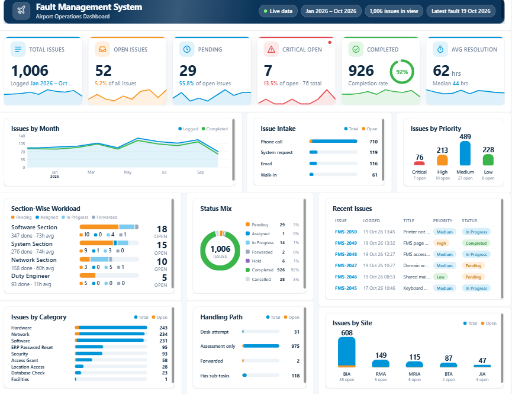

# ✈️ Fault Management System Dashboard | Power BI

An interactive Power BI dashboard designed to visualize and analyze airport fault management data. This project demonstrates how business intelligence tools can be used to monitor issues, track resolution performance, and identify operational trends.

> **Note:** This is a sample dashboard created using a sample dataset for learning and demonstration purposes. The data and figures shown are illustrative and do not represent actual airport operational records.

## 📊 Dashboard Preview



## 🎯 Project Objectives

- Monitor and analyze fault and issue records.
- Track open, pending, and completed issues.
- Identify critical issues and analyze fault priorities.
- Analyze monthly issue trends and completion rates.
- Compare workloads across sections and divisions.
- Evaluate issue resolution performance.
- Identify frequently reported fault categories and locations.

## 📈 Dashboard Features

### 1. Key Performance Indicators (KPIs)
- Total Issues
- Open Issues
- Pending Issues
- Critical Open Issues
- Completed Issues
- Average Resolution Time

### 2. Issue Trend Analysis
Visualizes monthly issue trends and compares logged issues with completed issues.

### 3. Issue Intake Analysis
Displays how issues are reported through different channels, such as phone calls, system requests, email, and walk-ins.

### 4. Priority Analysis
Provides a breakdown of issues by priority, including Critical, High, Medium, and Low.

### 5. Section-Wise Workload
Compares the workload of different sections and shows issue statuses to help identify areas requiring attention.

### 6. Status Distribution
Displays the distribution of issues across different statuses, including pending, assigned, in progress, forwarded, on hold, completed, and cancelled.

### 7. Category Analysis
Highlights frequently reported issue categories, such as hardware, network, software, and security.

### 8. Site Analysis
Compares issue counts across different airport sites.

### 9. Recent Issues
Provides a summary of recent issue records, including issue IDs, logged dates, titles, priorities, and statuses.

## 🛠️ Tools & Technologies

- **Microsoft Power BI Desktop** — Dashboard development and visualization
- **Power Query** — Data cleaning and transformation
- **DAX** — Measures and KPI calculations
- **Data Modeling** — Organizing data for analysis
- **Sample Dataset** — Demonstration and testing

## 📂 Project Structure

```text
Power-BI-Fault-Management-Dashboard/
│
├── README.md
├── dashboard.png
└── Fault_Management_Dashboard.pbix
```

- `README.md` — Project documentation
- `dashboard.png` — Dashboard preview image
- `Fault_Management_Dashboard.pbix` — Power BI project file

## 🚀 How to Explore the Project

1. Clone or download this repository.
2. Download and install Microsoft Power BI Desktop.
3. Open the `.pbix` file using Power BI Desktop.
4. If prompted, configure the data source to use the sample dataset included with the project.
5. Refresh the data if necessary.
6. Explore the dashboard visuals and interactive filters.

## 💡 Key Insights

The dashboard demonstrates how fault management data can be used to:

- Monitor issue resolution and completion rates.
- Identify critical and high-priority issues.
- Compare workloads across operational sections.
- Analyze frequently reported fault categories.
- Compare issue volumes across locations.
- Track changes in issue volumes over time.

*All insights are based on the sample dataset and are intended for demonstration purposes.*

## 📚 Disclaimer

This project is an independent demonstration of Power BI dashboard development using sample data. It is not an official operational dashboard, and the displayed metrics should not be interpreted as actual airport performance statistics.

## 👩‍💻 Author

**Amintha Jayasooriya**

Data Science Undergraduate | Power BI | Data Analytics | Business Intelligence

---

⭐ If you find this project useful, feel free to explore the repository.
